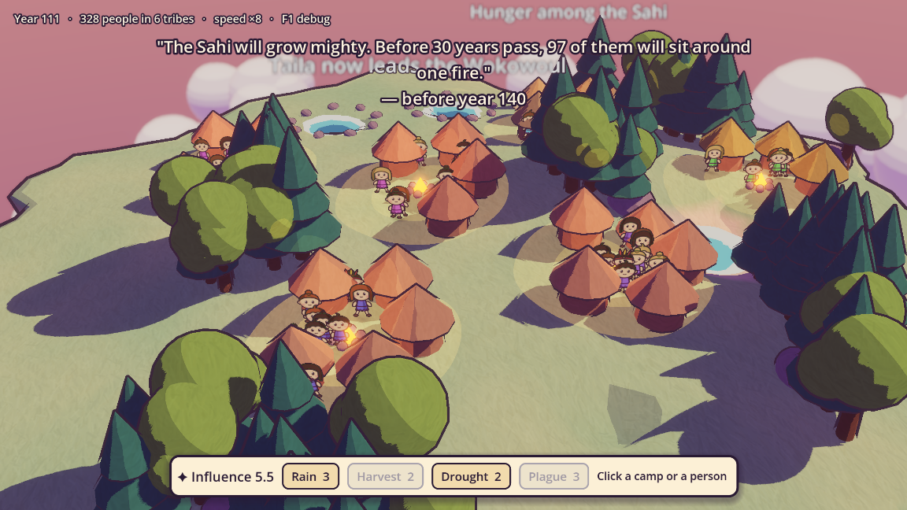

# My AI Planet

A hand-drawn 2.5D life simulation. You nurture a tiny planet from its first cell to floating cloud cities, while an AI Oracle predicts its future and you try to change it. See [ROADMAP.md](ROADMAP.md).

## Run

Open `Godot/` in Godot 4.7, then press Play. The current build is the first playable loop: the Oracle makes a prophecy, you nudge the world with miracles, and a chronicle tells you how it turned out. Underneath, tribes drink from the pond and two springs, need food, water, room and safety, and grow to love or hate each other: rivals go to war, and small tribes join their friends. Every figure is a named citizen; each tribe's oldest is its chief, and the chief's traits steer the tribe.

| Key | Action |
|---|---|
| Space | Pause |
| Click a person | Inspect them: traits, the tribe's needs, neighbors, what they're thinking |
| Click a camp | Choose a tribe for Harvest or Plague (and inspect its chief) |
| Esc | Close the inspector |
| Enter | Continue after a reveal |
| 1 / 2 / 3 | Speed, or pick a choice while a dilemma card is up |
| S / L | Save / load |
| F1 | Debug panel |
| Drag / wheel | Orbit / zoom |

## AI providers

Until the AI Settings screen exists, the provider comes from environment variables:

- `ANTHROPIC_API_KEY` set: uses the Claude API.
- Otherwise, if the `claude` or `grok` CLI is installed: uses it with your existing login (Claude Code first).
- Otherwise: offline templates.

Force one with `MYAIPLANET_AI=offline|anthropic|claude_code|grok_cli`. A typical prophecy plus chronicle costs about $0.04 with Claude Code and $0.13 with Grok CLI.

## Tests

```sh
scripts/test.sh                              # all tests, headless
scripts/test.sh determinism                  # only tests whose name matches
MYAIPLANET_LIVE_AI=1 scripts/test.sh live_ai # real AI calls (costs money)
```

Balance report (12 seeds, 300 years, offline AI, a bot that plays kindly):

```sh
godot --headless --path Godot -s res://tools/balance_report.gd -- years=300 seeds=12
```

The brush-stroke texture is painted by a script: `godot --headless --path Godot -s res://tools/paint_textures.gd`.

`scripts/test.sh` uses `godot` from your PATH, or `GODOT_PATH`, or `/Applications/Godot.app`.

## Screenshots

`scripts/screenshot.sh out.png [frames] -- --seed=42 --warmup-years=110 --distance=15 --pitch=-0.6 --yaw=3.8 --fast-forward-years=200` renders a frame (it opens a window briefly).


