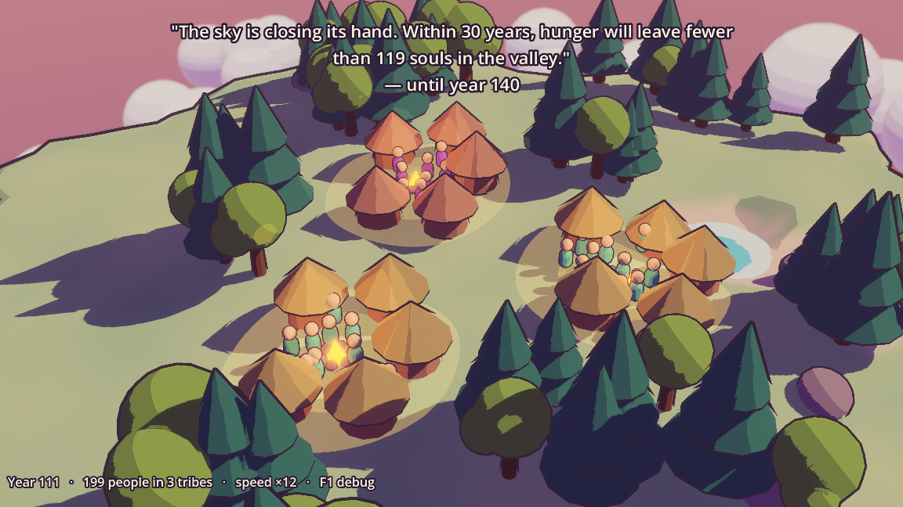

# My AI Planet

A hand-drawn 2.5D life simulation. You nurture a tiny planet from its first cell to floating cloud cities, while an AI Oracle predicts its future and you try to change it. See [ROADMAP.md](ROADMAP.md).

## Run

Open `Godot/` in Godot 4.7, then press Play. The current build is the M1 look prototype: the live simulation on a floating island.

| Key | Action |
|---|---|
| Space | Pause |
| 1 / 2 / 3 | Speed |
| P | Ask the Oracle for a prophecy |
| S / L | Save / load |
| F1 | Debug panel |
| Drag / wheel | Orbit / zoom |

## AI providers

Until the AI Settings screen exists, the provider comes from environment variables:

- `ANTHROPIC_API_KEY` set: uses the Claude API.
- Otherwise, if the `claude` or `grok` CLI is installed: uses it with your existing login (Claude Code first).
- Otherwise: offline templates.

Force one with `MYAIPLANET_AI=offline|anthropic|claude_code|grok_cli`.

## Tests

```sh
scripts/test.sh                              # all tests, headless
scripts/test.sh determinism                  # only tests whose name matches
MYAIPLANET_LIVE_AI=1 scripts/test.sh live_ai # real AI calls (costs money)
```

`scripts/test.sh` uses `godot` from your PATH, or `GODOT_PATH`, or `/Applications/Godot.app`.

## Screenshots

`scripts/screenshot.sh out.png [frames] -- --seed=42 --warmup-years=110 --distance=15 --pitch=-0.6 --yaw=3.8 --prophecy` renders a frame (it opens a window briefly).


