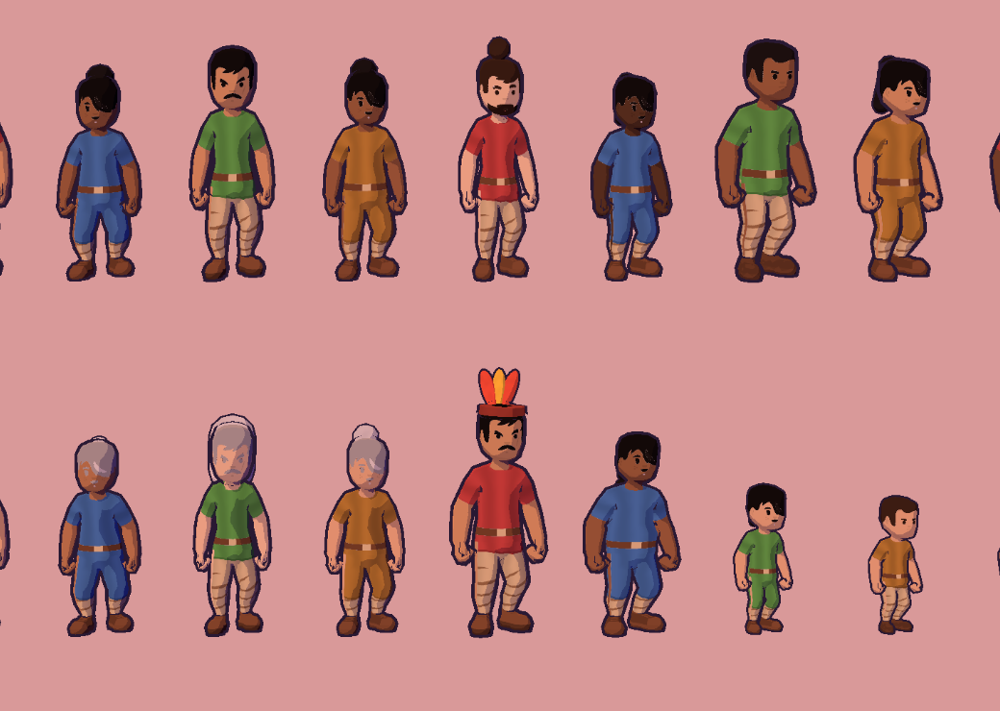

# Art Bible

The rules every asset is checked against. The look: a hand-painted miniature world floating in the sky, toon-shaded with ink outlines and soft, colored shadows.

## Shading

| Rule | Value | Where |
|---|---|---|
| Light bands | 3 steps (half-Lambert, floored) | `art/shaders/toon.gdshader` |
| Shadows | Never grey or black: the environment's ambient color (violet) fills them | `Diorama._build_environment` |
| Rim light | Thin warm rim on the lit side | toon shader `rim_*` |
| Outlines | Ink `#291a33`, inverted hull. Island 0.06, props 0.025–0.03, people a hair-thin line | `art/shaders/outline.gdshader` |
| Brush strokes | A painted stroke texture, projected from three sides, varies value ±22% and warmth ±12% on every toon surface | `art/textures/brush_strokes.png`, toon shader `stroke_*` |
| Clouds | Unlit painted gradient, bright tops to lavender bottoms, 4 steps | `art/shaders/cloud.gdshader` |
| Water | Flat color, two tones, a foam line where it meets the shore | `art/shaders/water.gdshader` |
| Camera | 32° field of view, near and far blur (tilt-shift miniature) | `game/diorama/camera_rig.gd` |

New models must have **smooth normals** (or the outline cracks) and use the shared materials from `ToonMaterials`. Don't create one-off materials.

## Era palettes

Each era has a sky, ambient (shadow) color, sun color and fog color. Only Era 3 exists so far.

| Era | Sky top / horizon / bottom | Ambient (shadows) | Sun | Fog | Mood |
|---|---|---|---|---|---|
| 3 First Fires | `#291a57` / `#fa9485` / `#7a427a` | `#805cb3` | `#ffcc9e` | `#db8f9e` | Warm dusk, campfire glow |
| 1 Primordial Soup | deep teal / cyan | teal | pale green | sea green | Bioluminescent |
| 4 Kingdoms | parchment gold / cream | warm brown | gold | sand | Old map |
| 6 Cloud Age | violet / magenta | indigo | neon pink | magenta | Neon night (the Cloud City reference) |

## Materials (Era 3)

| Thing | Color |
|---|---|
| Grass | `#57b35c` → `#8fd166` (noise blend) |
| Cliff | grass overhang → `#b88057` → `#85523d` → rock |
| Rock underside | `#855c75` → `#5c3352` |
| Pines / leafy trees | `#337a70` / `#80b857` |
| Thatch roofs | `#db9e5c`, tinted 25% toward the tribe's hue |
| People | tunic in the tribe's hue, five skin tones from `#f5c7a3` to `#6b4a38`, five hair colors from black to sand |
| Chief's headdress | band `#8c3830`, feathers `#e6543d` and `#f2bf40` |

**Drought:** green tones shift toward straw `#cca866` (the toon shader's `dryness`) and back when the rain returns. The world's state should always be readable from the colors.

## Motion

- Things appear by popping in (scale with an overshoot, 0.45 s) and leave by shrinking (0.6 s).
- People stroll to a spot, stand a while, then walk on, easing between standing and walking.
- Fires flicker in both flame height and light.
- The camera drifts slowly when nobody touches it.

## People

People are low-poly 3D figures, toon-shaded and ink-outlined like everything else. The base is Kenney's *Animated Characters* model with its idle and run clips (CC0, `art/characters/kenney/`). Adults have their head bone at 70% of Kenney's size, so they read as adults, not cartoon kids. Walking blends idle with a slowed run.

**Every camp is mixed.** A citizen's id fixes how they look for life (`VillagerArt.appearance`):

| Trait | Range |
|---|---|
| Ancestry | One of five, each a set of skin tones, hair colors and eye shapes that go together (fair with any hair color; East Asian with narrow eyes; brown-skinned with black or dark hair; dark-skinned; brown-skinned with narrow eyes half the time) |
| Sex | From the simulation. Women wear a mid-calf dress and have slightly narrower shoulders and wider hips |
| Face | Three men's faces (with or without a beard), one woman's face; round or narrower eyes |
| Hair | Painted short crop, plus a long fall, bun, ponytail, braid or topknot (low-poly pieces on the head bone) |
| Build | Slim, average or stout (bone scales on hips, spine and chest), height ±6% |
| Age | From 55, hair greys in four steps and the back stoops |
| Children | Not citizens: one child per 15 people (up to four) runs around each camp, 62% of adult size with a larger head |

| Part | Where |
|---|---|
| Model and clips | `art/characters/kenney/characterMedium.fbx`, `idle.fbx`, `run.fbx` |
| Skins and masks | `art/characters/villager_<face>[_narrow][_beard]_{skin,mask}.png`, painted by `tools/paint_villager_skins.gd` (mask: red = tunic, green = hair, blue = skin) |
| Shader | `art/shaders/villager.gdshader` (toon light plus per-figure colors) |
| Body shape | `game/diorama/villager_pose.gd`, a skeleton modifier applied after the animation |
| Chief | A leather band with three feathers on the head bone |

**Outfit (Era 3):** a tunic in the tribe's color with a collar and leather belt `#6b4530`, bare forearms, linen leggings `#ccb894` with leather wraps, leather shoes. No modern clothing details; new eras get new skins painted the same way.

## Props

Trees, bushes, flowers, mushrooms, rocks, logs, tents, campfires and camp belongings come from Kenney's *Nature Kit* and *Survival Kit* (CC0, `art/props/kenney/`), loaded by `game/diorama/kit.gd`. Every kit material is replaced with a toon material in this bible's palette, looked up by the kit's material name (`Kit.PALETTE`), and every model gets an ink outline hull with smoothed normals (the kit is flat-shaded, which would crack an ordinary hull). Tent canvas is linen tinted 45% toward the tribe's color. To add a prop, copy the `.glb` into `art/props/kenney/` and map any new material names in `Kit.PALETTE`.

## Painted textures

`tools/paint_textures.gd` paints `brush_strokes.png` from a fixed seed: red is light and dark strokes, green is warm and cool strokes. A hand-painted texture can replace it, as long as it tiles and stays centered on mid-grey (0.5 means no change).

## Placeholders left

The campfire flame (a few glowing cones) and the clouds are still built in code.
