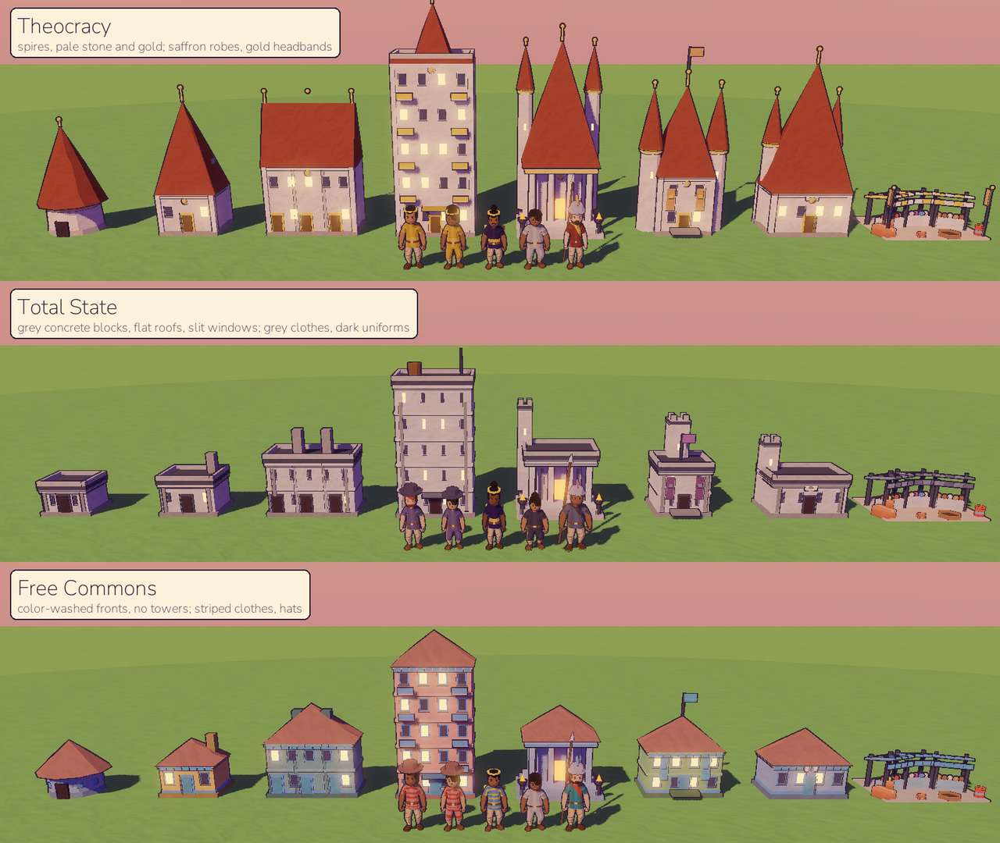
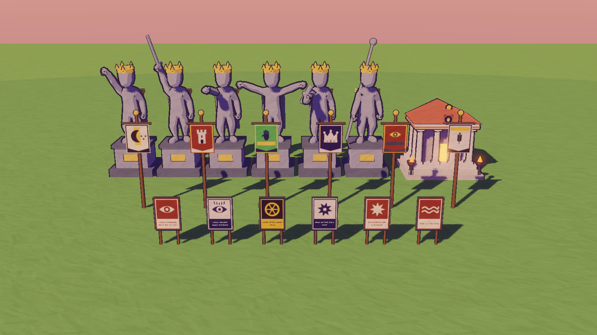

# Art Bible

The rules every asset is checked against. The look: a hand-painted miniature world floating in the sky, toon-shaded with ink outlines and soft, colored shadows.

## Shading

| Rule | Value | Where |
|---|---|---|
| Light bands | 3 steps (half-Lambert, floored) | `art/shaders/toon.gdshader` |
| Shadows | Never grey or black: the environment's ambient color (violet) fills them | `Diorama._build_environment` |
| Rim light | Thin warm rim on the lit side | toon shader `rim_*` |
| Outlines | Ink `#291a33`, inverted hull. Island 0.06, props 0.025–0.03, people a hair-thin line | `art/shaders/outline.gdshader` |
| Brush strokes | A painted stroke texture, projected from three sides, varies value ±22% and warmth ±12% on every toon surface | `art/textures/brush_strokes.png`, toon shader `stroke_*` |
| Clouds | Unlit painted gradient, bright tops to lavender bottoms, 4 steps | `art/shaders/cloud.gdshader` |
| Water | Flat color, two tones, a foam line where it meets the shore | `art/shaders/water.gdshader` |
| Camera | 32° field of view, near and far blur (tilt-shift miniature) | `game/diorama/camera_rig.gd` |

New models must have **smooth normals** (or the outline cracks) and use the shared materials from `ToonMaterials`. Don't create one-off materials.

## Era palettes

Each era has a sky, ambient (shadow) color, sun color and fog color. Only Era 3 exists so far.

| Era | Sky top / horizon / bottom | Ambient (shadows) | Sun | Fog | Mood |
|---|---|---|---|---|---|
| 3 First Fires | `#291a57` / `#fa9485` / `#7a427a` | `#805cb3` | `#ffcc9e` | `#db8f9e` | Warm dusk, campfire glow |
| 1 Primordial Soup | deep teal / cyan | teal | pale green | sea green | Bioluminescent |
| 4 Kingdoms | parchment gold / cream | warm brown | gold | sand | Old map |
| 6 Cloud Age | violet / magenta | indigo | neon pink | magenta | Neon night (the Cloud City reference) |

## Materials (Era 3)

| Thing | Color |
|---|---|
| Grass | `#57b35c` → `#8fd166` (noise blend) |
| Cliff | grass overhang → `#b88057` → `#85523d` → rock |
| Rock underside | `#855c75` → `#5c3352` |
| Pines / leafy trees | `#337a70` / `#80b857` |
| Thatch roofs | `#db9e5c`, tinted 25% toward the tribe's hue |
| People | tunic in the tribe's hue, five skin tones from `#f5c7a3` to `#6b4a38`, five hair colors from black to sand |
| Chief's headdress | band `#8c3830`, feathers `#e6543d` and `#f2bf40` |

**Drought:** green tones shift toward straw `#cca866` (the toon shader's `dryness`) and back when the rain returns. The world's state should always be readable from the colors.

## Motion

- Things appear by popping in (scale with an overshoot, 0.45 s) and leave by shrinking (0.6 s).
- People stroll to a spot, stand a while, then walk on, easing between standing and walking.
- Fires flicker in both flame height and light.
- The camera drifts slowly when nobody touches it.

## People

People are low-poly 3D figures, toon-shaded and ink-outlined like everything else. The base is Kenney's *Animated Characters* model with its idle and run clips (CC0, `art/characters/kenney/`). Adults have their head bone at 70% of Kenney's size, so they read as adults, not cartoon kids. Walking blends idle with a slowed run.

**Looks come from DNA.** Every person is drawn, and their genes decide what can be inherited, so children look like a mix of their parents (`VillagerArt.appearance_of`):

| Trait | Range |
|---|---|
| Skin, hair | The pigment and hair genes pick a point along the skin-tone and hair-color palettes. The first people come from two of five ancestries, so a tribe starts mixed and drifts |
| Eye shape | Narrow eyes are recessive: they show only when both copies carry them |
| Height, build | The height gene gives ±10%; the build gene gives slim, average or stout (bone scales on hips, spine and chest) |
| Sex | From the simulation. Women wear a mid-calf dress and have slightly narrower shoulders and wider hips |
| Face, hair style, beard | Chosen by the person's id, not inherited: three men's faces, one woman's face; a painted crop plus a long fall, bun, ponytail, braid or topknot |
| Age | Babies are a third of adult size and children grow every year, with larger heads. From 55, hair greys in four steps and the back stoops |
| Work | Workers hold the tool of their trade (axe, hammer, hoe, pickaxe, spear, fishing rod, basket, bowl), stoop or swing while they work, and carry wood, stone, fish or food home |

| Part | Where |
|---|---|
| Model and clips | `art/characters/kenney/characterMedium.fbx`, `idle.fbx`, `run.fbx` |
| Skins and masks | `art/characters/villager_<face>[_narrow][_beard]_{skin,mask}.png`, painted by `tools/paint_villager_skins.gd` (mask: red = tunic, green = hair, blue = skin) |
| Shader | `art/shaders/villager.gdshader` (toon light plus per-figure colors) |
| Body shape | `game/diorama/villager_pose.gd`, a skeleton modifier applied after the animation |
| Chief | A leather band with three feathers on the head bone |

**Outfit (Era 3):** a tunic in the tribe's color with a collar and leather belt `#6b4530`, bare forearms, linen leggings `#ccb894` with leather wraps, leather shoes. No modern clothing details; new eras get new skins painted the same way.

## Props

Trees, bushes, flowers, mushrooms, rocks, logs, tents, campfires, camp belongings, tools, fences, barrels and the workshop come from Kenney's *Nature Kit* and *Survival Kit* (CC0, `art/props/kenney/`), loaded by `game/diorama/kit.gd`. Every kit material is replaced with a toon material in this bible's palette, looked up by the kit's material name (`Kit.PALETTE`), and every model gets an ink outline hull with smoothed normals (the kit is flat-shaded, which would crack an ordinary hull). Tent canvas is linen tinted 45% toward the tribe's color. To add a prop, copy the `.glb` into `art/props/kenney/` and map any new material names in `Kit.PALETTE`.

## Villages

Each tribe is a village of rings around its fire (`game/diorama/settlement.gd`): homes on the inner ring, workshops, stores, the healer's hut and the shrine on the middle ring, fields on the outer ring, graves in rows on the far side. Buildings rise out of a site (stakes and a pile of planks) as builders work, and the land is cleared as the village grows: trees in the way are felled to stumps.

| Building | Look (`game/diorama/building_art.gd`) |
|---|---|
| Tent | Kit tent, linen tinted toward the tribe |
| Hut | Round daub wall `#cca37a` under a cone of thatch `#db9e5c` tinted 25% toward the tribe, dark doorway facing the fire |
| Longhouse | Long daub hall under a ridged thatch roof, corner posts `#80573d` |
| Healer's hut | A smaller hut with a greener thatch, herbs and a pot by the door |
| Storehouse | A hut raised on stilts, with barrels, crates and jars |
| Workshop | Kit shed roof over a workbench and planks |
| Shrine | A ring of six standing stones around a flat altar stone |
| Field | Tilled soil with rows of crop tufts that sprout, green, turn golden at harvest and go bare in winter |
| Palisade | Kit fortified fence segments all around the homes, with a gate |
| Grave | A low mound and a flat stone; a standing stone for a chief |

Later ages add an outer ring (mines, factories, prisons, towers) and a stone wall that replaces the palisade. All of it is built from simple shapes plus kit props, merged into one mesh per building and tinted toward the tribe. The look grows more industrial with each age, and the buildings of control use colder, greyer stone:

| Building | Look |
|---|---|
| Stone house, row house, apartment block | Stone cottage; two-storey brick terrace with chimneys; a five-storey block with lit windows |
| Mine, smithy, school, market | Timber-framed shaft with an ore cart; a forge with flickering coals and an anvil; a school with a belfry; striped market stalls |
| Temple, great house | A columned stone temple; the ruler's seat with towers and banners in the tribe's color |
| Factory | Brick, sawtooth roof, a tall chimney with smoke |
| Stone wall | Crenellated wall with towers and a gatehouse all around the village |
| Barracks, prison | Grey stone; the prison has bars and a yard where the detained pace |
| Watchtower | A lookout with a brazier, then a sweeping searchlight from Smoke & Steam on |
| Statue | A villager frozen in grey stone, fist raised, crowned and cloaked, on a plinth |
| Broadcast tower | A red-and-white lattice mast with blinking lights |
| Surveillance mast | A steel pole with red-eyed cameras and a cold searchlight cone sweeping the ground: the dystopia's signature |

Villagers carry the tools of the new trades (pickaxe, hammer, book, purse, scroll, wrench); guards wear a helmet with a crest in the tribe's color and carry a pike; nobles wear a deeper tunic, a gold circlet and a cloak, and the bonded wear undyed cloth. `tools/building_gallery.gd` lines everything up for a check.

### Styles and fashion (AI-authored)

Each tribe has a style for its age, government and destiny (`ai/assets/style_kind.gd`), written by the player's AI or offline. It never names a color or a shape: it picks palette indices (`ArtPalette`) and words from a grammar, and the game clamps them.

| Part | Choices | Where |
|---|---|---|
| Roof | cone, gable, dome (a barrel vault on long halls), stepped, flat (with a parapet), spire (a slender one on a block) | `game/diorama/styled_buildings.gd` |
| Walls | daub (a dark base band), timber (corner posts and floor beams), stone (quoins), plaster (pilasters and a cornice), brick (white string courses), concrete (floor slabs); never newer than the age allows | |
| Ornament | carved bands, painted (each kind of building washed in its own bright color), banners in the tribe's color, gilded bands and finials, grim (iron bands, slit windows, few lights) | |
| Towers, proportion | 0 to 2 towers on the temple, school and great house; squat, balanced or tall walls | |
| Fashion | a color per class (commoners, nobles, the bonded, guards), a pattern woven in the trim color (stripes, hem, checks, sash) and an accessory (headband, hat, hood, scarf, feather) | `VillagerArt.wear`, `villager.gdshader` |

Homes, the temple, the great house, the school and the market take the style; the buildings of control keep their cold grey stone. The offline styles make the society readable: a Theocracy grows spires and gold, a Total State goes grey, flat-roofed and brutal with guards in dark uniforms, a Free Commons is a colorful patchwork; nobles wear their own finer color with a gold hem, the bonded plain drab. `tools/building_gallery.gd --show=styles` lines them up.

## Banners, posters and monuments

The player's AI writes them as small specs (or the game does, offline), and the game draws them in this bible's palette (`ai/assets/heraldry_kind.gd`, `poster_kind.gd`, `monument_kind.gd`; drawn by `game/diorama/emblem_art.gd` and `settlement.gd`). Emblems are SVG on a 64-unit square, in palette indices only, cleaned by `SvgGuard` (basic shapes and paths: no text, styles or links) and rasterized with `Image.load_svg_from_string`.

| Thing | Look |
|---|---|
| Banner | Hangs from a crossbar on a pole with a gold knob, by the fire, then in front of the great house. The cloth is the house's field color with a gold trim (ink on light fields), the emblem, and a band of the emblem's color at the foot. A new house, a coup, a revolution or a new ruling faction hangs a new one |
| Emblem | Bold and simple, like a woodcut. Offline, `EmblemGrammar` draws a charge (sun, moon, star, tree, wave, eye, crown, flame, hand, mountain, wheel, tower, fish, grain), sometimes over an ordinary (border, chief, pale, per pale, bend, chevron, base) |
| Poster | A painted board on two posts for every dark law: paper and print colors, a motif, and the slogan lettered in capitals in the band at its foot. In front of the broadcast towers, surveillance masts and seats of power first, then along the inside of the wall, then around the fire |
| Statue | The ruler's pose shows their vanity: fist raised, sword held high, pointing the way, arms open, holding out a scroll, or leaning on a staff |
| Temple | Its holy sign in gold on a dark roundel, on the front of the pediment |

## Islands and atmosphere

Each biome (`game/diorama/biome_look.gd`) has its own ground, leaf, grass and stone colors (swapped onto kit materials by name), tree mix and plant counts: meadow is the classic look; steppe is straw-gold grass and ochre with few trees and sandstone; jungle is deep saturated green, dense and tall; taiga is dark blue-green pines with snow in winter; highland is grey-violet rock, boulders and wind-bent trees.

The sky and light follow the sim (`game/diorama/atmosphere.gd`): the island's gloom (its population-weighted dystopia) desaturates and cools everything, with a colder sun, grey-blue shadows (never black), an overcast sky and thicker fog; factory smog browns the sky and adds haze; the Wired Age adds a low amber city glow on the horizon. A dystopia should feel oppressive but stay readable and on style.

## Painted textures

`tools/paint_textures.gd` paints `brush_strokes.png` from a fixed seed: red is light and dark strokes, green is warm and cool strokes. A hand-painted texture can replace it, as long as it tiles and stays centered on mid-grey (0.5 means no change).

## UI

The HUD is paper and ink laid over the diorama: cream cards with the world's ink line and a soft violet shadow, two typefaces, and small two-tone icons. It stays calm so the island is the star. Everything is built in code from `game/ui/ui_style.gd` (tokens, theme, builders) and `game/ui/ui_icons.gd` (icons).

**Type.** [Fraunces](https://github.com/undercasetype/Fraunces) (SIL OFL 1.1) for titles, the date, the island's name and the Oracle's words (italic); [Nunito](https://github.com/googlefonts/nunito) (SIL OFL 1.1) for everything else. Both are variable fonts in `art/ui/fonts/` with their licenses. Symbols the fonts lack (✦ ⚑ ⚔ ...) fall back to the engine's font.

| Token | Value | Use |
|---|---|---|
| `CAPTION` / `SMALL` / `BODY` / `LEAD` / `TITLE` / `DISPLAY` | 11 / 12 / 14 / 16 / 20 / 26 px | dates and section heads / chips / text / story text / panel titles / chronicle titles |
| Faces | body Nunito 560, strong Nunito 780, caps Nunito 820 tracked +1, display Fraunces 600 (soft, wonky), quote Fraunces italic 420 | |
| `SPACE_1` … `SPACE_5` | 4, 8, 12, 16, 24 px | gaps and padding |
| `RADIUS_S` / `M` / `L` | 6 / 10 / 14 px | chips, buttons, cards |
| `BORDER` | 2 px of ink | cards and buttons; chips and bars 1 px |
| `MOTION_FAST` / `MOTION` / `MOTION_SLOW` | 0.14 / 0.2 / 0.45 s, cubic ease-out | hovers / panels / meters. Docks slide 18 px from their side, modals fade in from 97%. Nothing bounces |

| Color | Value | Use |
|---|---|---|
| Ink | `#291a33` | text, lines (the world's outline color) |
| Ink soft / faint / ghost | `#544261` / `#73637a` / `#a899a3` | secondary text / captions (4.5:1 on paper) / disabled |
| Paper / deep / sunk | `#fcf2db` / `#f5e0b8` / `#eddbbd` | cards / buttons and chips / wells, tracks, segmented controls |
| Gold / soft | `#f2b34d` / `#ffd994` | the god: Influence, pressed / hover |
| Oracle violet | `#6b4d9e` | the prophecy, the AI, a met goal |
| Good / bad / warn / dark | `#387a42` / `#b83d33` / `#cc8024` / `#942e4d` | outcomes, reasons, drought, dystopia |
| Scrim | ink-violet at 48% | dims the world under a modal (never black) |

**Pieces.** Cards (`Card`), small floating groups (`Plaque`), sunk areas (`Well`, `Segmented`). Buttons: secondary (paper), primary (ink-filled, one per card, moves the story on), ghost (icon buttons), chips (filters), tabs (inside a segmented well), nav and miracle tiles. Tooltips are dark ink with paper text, so they never read as another panel. Every panel has the same header: an icon, a Fraunces title and a ghost × at the right.

**Icons.** Ink-stamp icons on a 24-unit grid: an ink line (1.7 units, round joins) over one painted fill from the palette. They are SVG strings rasterized at 4× and drawn at their logical size, so they stay crisp at 1080p and on retina screens. Add one by adding its SVG body to `UiIcons.SHAPES`.

**Layout** (logical pixels; the canvas scales with the window, 1152×648 and up):

| Place | What |
|---|---|
| Top bar, 46 px, 12 px from the top | Left: the date and time (pause, 1× 3× 10× 30× 90×). Middle: the island's name, age and people, with chips under it (drought, smog, omens, destiny). Right: Feed, Genes, Society, Oracle (AI) and the keys. It stays above the scrim, always in reach |
| Left column, 300 px | The prophecy card (folds to a pill), then the life feed (250 px, unfolds to the column; its filters fold away) |
| Right dock, 360 px | One inspector at a time: a person or a tribe |
| Bottom, centered | The miracle bar: Influence, a tile per miracle (icon, name, cost badge), the target tribe. A hint ribbon above it says what a miracle does and why it can't be cast |
| Modals | Centered under the top bar over the scrim: a chronicle or a dilemma (they wait for their button), the charts and the keys (Esc or a click on the scrim closes them), the AI settings. The last opened is on top |

Keys are shortcuts, never the only way: each button's tooltip ends with its key in brackets, and the keys card lists them all.

## Placeholders left

The campfire flame (a few glowing cones) and the clouds are still built in code.
